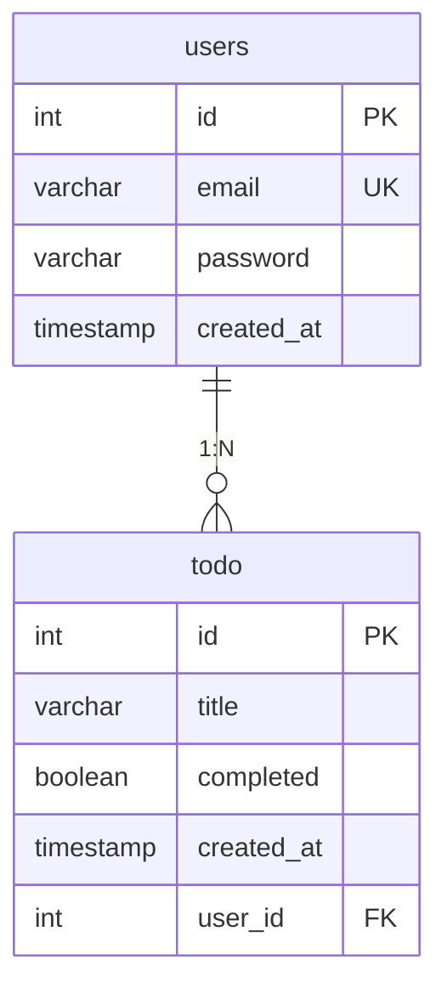

# Todo 관리 웹 애플리케이션
 
NestJS와 Next.js로 프론트엔드와 백엔드를 함께 구현한 Todo 관리 웹 애플리케이션입니다.
실무에서 다루기 어려웠던 프론트-백엔드 통신 구조와 에러 응답 설계를 직접 처음부터 끝까지 설계해보기 위해 시작했습니다.
 
<!-- 실행 화면 GIF나 스크린샷 삽입예정 -->
<!--  -->


  
## 목차
 
- [기술 스택](#기술-스택)
- [아키텍처](#아키텍처)
- [ERD](#erd)
- [주요 기능](#주요-기능)
- [API 명세](#api-명세)
- [트러블슈팅 / 기술적 의사결정](#트러블슈팅--기술적-의사결정)
- [실행 방법](#실행-방법)
- [폴더 구조](#폴더-구조)


  
## 기술 스택
 
| 구분 | 기술 |
|------|------|
| Backend | NestJS |
| Database | PostgreSQL (Supabase) |
| ORM | TypeORM |
| Auth | JWT (@nestjs/jwt), bcrypt |
| Validation | class-validator, class-transformer |
| Frontend | Next.js |
| Tool | Git, VS Code |


  
## 아키텍처
 
<!-- 프론트-백엔드 요청/응답 흐름과 Controller-Service-Module 계층 구조도를 삽입하세요 -->
<!-- 예: Next.js(Client) → NestJS Controller → Service → TypeORM → SQLite -->
 
```
[Next.js Client]
      │  REST API (fetch)
      ▼
[NestJS Controller]
      │
      ▼
[Service Layer]
      │
      ▼
[TypeORM] ──▶ [PostgreSQL (Supabase)]
```


  
## ERD
 


- 한 유저는 여러 Todo를 가지며, 외래 키는 N 쪽인 `todo.user_id`에만 존재합니다.
- 조회가 항상 Todo 기준으로 이루어지므로 `@ManyToOne` 단방향 관계로 설계했습니다.
- 유저 삭제 시 해당 유저의 Todo도 함께 삭제됩니다 (`ON DELETE CASCADE`).
- DB 컬럼은 snake_case, 코드(엔티티)는 camelCase를 사용하며 `SnakeNamingStrategy`로 자동 매핑합니다. (`createdAt` ↔ `created_at`)

  
  <br>
  
## 주요 기능


### Todo

- **Todo CRUD**: 등록·수정·삭제 및 완료/미완료 상태 변경
- **키워드 검색**: LIKE 검색 기반 제목 검색
- **필터링**: 완료 상태별 목록 필터링
- **Optimistic UI**: 클라이언트에서 즉시 반영 후, 실패 시 롤백되는 에러 응답 구조
- **페이지네이션**: 서버 사이드 페이지네이션 적용 page, limit 기반으로 필요한 Todo 데이터만 조회, 전체 데이터 개수에 따라 페이지 버튼을 동적으로 생성
- **정렬**: Todo 조회 API에 정렬 기준(최신순, 오래된순, 제목순)과 정렬 방향을 적용하여 기능 구현


### 회원가입 / 로그인
 
- **회원가입**: 이메일 형식·비밀번호 길이(8자 이상)를 DTO로 검증하고, 이메일 중복 시 409 응답
- **비밀번호 보호**: bcrypt로 해싱하여 저장하며, 엔티티에서 `select: false`로 지정해 일반 조회 시 응답에 포함되지 않도록 함
- **JWT 로그인**: 로그인 성공 시 유효기간 1시간의 access token 발급, 서명 키는 환경변수(`JWT_SECRET`)로 분리
- **계정 정보 노출 방지**: 존재하지 않는 이메일과 비밀번호 불일치에 동일한 401 메시지를 반환해, 가입 여부를 추측할 수 없도록 함
  
  <br>
## API 명세
 
### 공통 에러 응답 형식
 
모든 에러는 아래 형식으로 응답합니다. DTO 검증 실패(400)의 경우 `message`가 배열로 반환됩니다.
 
```json
{
  "message": "에러 메시지",
  "error": "Bad Request",
  "statusCode": 400
}
```
 
| 상태 코드 | 의미 |
| --- | --- |
| 400 | 요청 데이터 검증 실패 |
| 401 | 인증 실패 |
| 409 | 리소스 중복 (이메일 중복) |
 
 <br>

### POST /auth/signup
회원가입
 
**Request Body**
 
| 필드 | 타입 | 필수 | 설명 |
| --- | --- | --- | --- |
| email | string | Y | 이메일 형식 |
| password | string | Y | 8자 이상 |
 
**Response** `201 Created`
 
```json
{ "id": 1, "email": "test@test.com" }
```
 
**Error**
 
| 상태 코드 | 상황 |
| --- | --- |
| 400 | 이메일 형식 오류, 비밀번호 8자 미만 |
| 409 | 이미 가입된 이메일 |
 
```json
{
  "message": ["비밀번호는 8자 이상이어야 합니다."],
  "error": "Bad Request",
  "statusCode": 400
}
```
 
  
### POST /auth/login
로그인 및 access token 발급
 
**Request Body**
 
| 필드 | 타입 | 필수 | 설명 |
| --- | --- | --- | --- |
| email | string | Y | 가입한 이메일 |
| password | string | Y | 비밀번호 |
 
**Response** `200 OK`
 
```json
{ "accessToken": "eyJhbGciOiJIUzI1NiIs..." }
```
 
**Error**
 
| 상태 코드 | 상황 |
| --- | --- |
| 400 | 요청 형식 오류 |
| 401 | 이메일 또는 비밀번호 불일치 |
 
```json
{
  "message": "이메일 또는 비밀번호가 올바르지 않습니다.",
  "error": "Unauthorized",
  "statusCode": 401
}
```
 
 <br>

### GET /todos
Todo 목록 조회
 
**Query Parameters**
 
| 이름 | 타입 | 필수 | 설명 |
| --- | --- | --- | --- |
| keyword | string | N | 제목 검색 키워드 (LIKE 검색) |
| isDone | boolean | N | 완료 상태 필터 |

  
### POST /todos
Todo 등록
 
**Request Body**
 
| 필드 | 타입 | 필수 | 설명 |
| --- | --- | --- | --- |
| title | string | Y | 할 일 제목 |

  
### PATCH /todos/:id
Todo 수정 (완료 상태 변경 포함)
 
**Path Parameter**
 
| 이름 | 타입 | 설명 |
| --- | --- | --- |
| id | number | 수정할 Todo의 ID |
 
**Request Body**
 
| 필드 | 타입 | 필수 | 설명 |
| --- | --- | --- | --- |
| title | string | N | 수정할 제목 |
| isDone | boolean | N | 수정할 완료 상태 |

   
### DELETE /todos/:id
Todo 삭제
 
**Path Parameter**
 
| 이름 | 타입 | 설명 |
| --- | --- | --- |
| id | number | 삭제할 Todo의 ID |


  <br>
  
## 트러블슈팅 / 기술적 의사결정


  
### 1. SQLite에서 PostgreSQL(Supabase)로 전환

**초기 선택**: 개인 프로젝트 규모에서 별도 DB 서버 설치 없이 빠르게 개발하기 위해 SQLite를 사용함

**전환 이유**: 배포를 준비하면서, PaaS 환경은 재배포 시 서버 파일 시스템이 초기화되어 파일 기반인 SQLite 데이터가 유실될 수 있다는 문제를 확인함. 애플리케이션 서버와 DB를 분리하기 위해 외부 관리형 DB로 전환함

**Supabase를 선택한 이유**
- 무료 플랜으로 PostgreSQL을 사용할 수 있음
- 대시보드에서 테이블과 데이터를 바로 확인할 수 있어 디버깅이 편리함

**전환 과정에서 적용한 설정**
- **환경변수 분리**: `@nestjs/config`로 DB 접속 정보를 `.env`에서 관리하고 저장소에는 올리지 않음
- **네이밍 전략**: PostgreSQL 관례에 맞춰 DB 컬럼은 snake_case로 두고, `SnakeNamingStrategy`로 엔티티의 camelCase와 자동 매핑
- **`synchronize: false`**: 엔티티와 DB 구조가 다를 때 TypeORM이 컬럼을 삭제 후 재생성해 데이터가 유실되는 것을 방지
- **id 타입을 int4로 지정**: Node의 pg 드라이버는 int8(bigint)을 문자열로 반환하기 때문에, 엔티티의 `id: number`와 타입을 맞추기 위해 int4 사용

  <br>
  
### 2. Optimistic UI의 에러 응답 구조 설계
클라이언트에서 먼저 상태를 반영한 뒤, 서버 응답 실패 시 이전 상태로 롤백

  <br>
  
### 3. 페이지 이동 시 필터·검색·정렬 조건이 초기화되는 문제

#### 문제 상황
- '완료' 필터를 적용한 상태에서 2페이지를 누르면 필터가 풀리고 전체 Todo 목록이 출력됨
- 검색어를 입력한 상태에서 페이지를 이동해도 검색 조건이 사라짐
- 정렬 옵션을 변경해도 목록이 다시 조회되지 않음
- 서버 에러 없이 결과만 잘못 나오는 로직 오류

#### 원인 분석
브라우저 Network 탭에서 실제 요청 URL을 확인한 결과, 페이지 이동 시 필터 파라미터가 빠진 채로 요청되고 있었음.

```
GET /todo?page=2&limit=10&order=DESC&sort=createdAt   ← completed 파라미터 누락
```

요청 URL에 필터가 없으므로 백엔드는 정상 동작했고, 원인은 프론트엔드에 있었음.

1. **조회 함수가 조건을 인자로 받는 구조**
   `fetchTodos(completed, searchWord)`처럼 조건을 인자로 받다 보니, 페이지 변경 시 `fetchTodos()`를 인자 없이 호출하면 필터와 검색어가 `undefined`로 전달됨
2. **정렬 값이 state가 아닌 일반 변수**
   `let sort = "createdAt"`은 렌더링마다 초기값으로 다시 생성되기 때문에, `useEffect(..., [sort])`가 정렬 변경을 감지하지 못함
3. **조건 변경 시 페이지가 초기화되지 않음**
   3페이지를 보다가 필터를 바꾸면 해당 필터의 3페이지를 요청해 빈 화면이 나올 수 있음

#### 해결 방법
조회 조건(페이지·필터·정렬·검색어)을 모두 state로 관리하고, 조회 함수는 인자 없이 **항상 현재 state를 읽도록** 변경. 조건이 바뀔 때 다시 조회하는 `useEffect`도 하나로 통합함.

**Before**
```tsx
const fetchTodos = async (completed?: string, searchWord?: string) => { ... };

useEffect(() => { fetchTodos(); }, [page]);   // 필터·검색어 누락
useEffect(() => { fetchTodos(); }, [sort]);   // sort가 state가 아니라 감지 안 됨
```

**After**
```tsx
const fetchTodos = async () => {
  const params = new URLSearchParams({ page: String(page), limit: String(limit), sort, order });
  if (filter !== "all") params.set("completed", filter);
  if (appliedSearch) params.set("searchWord", appliedSearch);
  // ...
};

// 조건 변경 시 1페이지로 이동
const handleFilter = (value) => { setFilter(value); setPage(1); };
const handleSearch = () => { setAppliedSearch(searchWord); setPage(1); };
const handleSort = (value) => { setSortName(value); setPage(1); };

// 조회 조건 중 하나라도 바뀌면 다시 조회
useEffect(() => {
  fetchTodos();
}, [page, filter, sortName, appliedSearch]);
```

검색은 입력 중인 값(`searchWord`)과 실제 적용된 값(`appliedSearch`)을 분리해, 검색 버튼을 눌렀을 때만 조회되도록 함.

#### 배운 점
- 화면 결과가 이상할 때는 **Network 탭에서 실제 요청 URL을 먼저 확인**하면 프론트·백엔드 중 어디가 문제인지 빠르게 구분할 수 있음
- 여러 조회 조건이 함께 동작하는 화면에서는 조건을 함수 인자로 흩어서 넘기기보다, **state를 단일 기준(Single Source of Truth)으로 두고 한 곳에서 요청을 만드는 구조**가 버그를 줄임
- `useEffect`의 의존성 배열에는 **렌더링 사이에 값이 유지되는 state**를 넣어야 변경을 감지할 수 있음

  <br>

### 4. 조회 결과가 0건일 때 다음 페이지 버튼이 활성화되는 문제

#### 문제 상황
- 완료 항목이 하나도 없는 상태에서 '완료' 필터를 누르면 목록은 비어 있는데 `›`, `»` 버튼이 활성화됨
- 버튼을 누르면 2페이지, 3페이지로 계속 이동하며 빈 목록을 요청함

#### 원인 분석
전체 페이지 수는 `Math.ceil(total / limit)`로 계산하는데, 결과가 0건이면 `totalPages`가 0이 됨.
버튼 비활성화 조건이 `page === totalPages`(1 === 0)라서 항상 `false`가 되어 버튼이 막히지 않았음.

#### 해결 방법
뒤로 가는 버튼의 조건을 `===`에서 `>=`로 변경해, 현재 페이지가 마지막 페이지 **이상**이면 비활성화되도록 함.

```tsx
// Before
disabled={page === totalPages}

// After
disabled={page >= totalPages}
```

앞으로 가는 버튼(`«`, `‹`)은 기존처럼 `page === 1`을 기준으로 유지함.

#### 배운 점
- 경계값 조건은 `===`보다 `>=`, `<=`처럼 **범위로 비교**하는 것이 예상치 못한 값(0건, 범위 초과)에 더 안전함
- 기능 구현 후 **데이터가 없는 경우, 첫 페이지, 마지막 페이지** 같은 경계 상황을 따로 테스트해야 함

  <br>

### 5. DTO 검증 규칙이 적용되지 않는 문제
 
#### 문제 상황
- 회원가입 DTO에 `@MinLength(8)`을 적용했지만, 3자리 비밀번호로 회원가입이 성공함
- 서버 에러 없이 잘못된 데이터가 그대로 DB에 저장됨
#### 원인 분석
class-validator의 데코레이터(`@IsEmail`, `@MinLength` 등)는 **검증 규칙을 선언할 뿐**, 실제 검증은 ValidationPipe가 수행함.
`main.ts`에서 `ValidationPipe`를 import만 하고 등록하지 않아, 규칙이 있어도 검증이 실행되지 않았음.
 
```ts
import { ValidationPipe } from '@nestjs/common';   // import만 되어 있음
// app.useGlobalPipes(...) 누락
```
 
#### 해결 방법
컨트롤러마다 `@UsePipes()`로 적용하는 방식과 전역 등록 방식 중, **누락 위험이 없는 전역 등록**을 선택함.
 
```ts
app.useGlobalPipes(new ValidationPipe({ whitelist: true }));
```
 
`whitelist: true` 옵션으로 DTO에 정의되지 않은 필드(예: `id`, `role`)는 자동으로 제거되어, 클라이언트가 의도하지 않은 값을 끼워 보내도 저장되지 않음.
 
#### 배운 점
- TypeScript 타입은 컴파일 후 사라지기 때문에 런타임에는 외부 입력을 검증해주지 않음. **외부 입력은 반드시 런타임 검증이 필요함**
- 데코레이터는 규칙의 선언이고, 그 규칙을 실행하는 주체(Pipe)가 별도로 있다는 NestJS의 구조를 이해함
- 기능 구현 후 **정상 케이스뿐 아니라 실패해야 하는 케이스(잘못된 입력)도 직접 요청해 확인**해야 함

  <br>

### 6. Supabase 공개 API 노출 차단 (RLS 활성화)
 
#### 문제 상황
users 테이블 생성 시 Supabase에서 RLS(Row Level Security)가 비활성화되어 있다는 경고가 표시됨
 
#### 원인 분석
Supabase는 테이블마다 공개 REST API를 자동으로 노출하며, RLS가 비활성화되어 있으면 공개 키(anon key)만으로 테이블을 조회·수정할 수 있음.
users 테이블에는 비밀번호 해시가 저장되므로 외부 노출 위험이 있었음.
 
#### 고민한 선택지
1. RLS 비활성화 유지
2. RLS 활성화 + Supabase 정책(policy)으로 행 단위 접근 제어
3. RLS 활성화 + 정책 없이 공개 API 접근 전체 차단
#### 선택과 이유
3번을 선택함. 이 프로젝트는 Supabase API가 아닌 NestJS 서버가 `DATABASE_URL`로 DB에 직접 접속하고, 인증·권한 처리는 애플리케이션 계층(JWT)에서 담당함.
서버 접속 계정은 테이블 소유자라 RLS의 영향을 받지 않으므로, 정책 없이 RLS만 활성화하면 **서버 동작은 유지하면서 외부 접근만 차단**할 수 있음.
 
```sql
alter table users enable row level security;
alter table todo enable row level security;
```
 
#### 결과
- Supabase 공개 API로는 users, todo 테이블에 접근할 수 없음
- 데이터 접근 경로를 NestJS 서버 하나로 통일해, 접근 제어 책임을 애플리케이션 계층에 둠

  
 <br>
  
## 실행 방법
 
### 1. 저장소 클론
 
```bash
git clone https://github.com/kimds777/nest-next-todo.git
```
 
### 2. 데이터베이스 준비
Supabase(또는 PostgreSQL)에서 아래 SQL로 테이블을 생성합니다. `synchronize: false`로 설정되어 있어 테이블이 자동으로 생성되지 않습니다.
 
```sql
create table users (
  id int4 generated by default as identity primary key,
  email text not null unique,
  password text not null,
  created_at timestamptz not null default now()
);
 
create table todo (
  id int4 generated by default as identity primary key,
  title text not null,
  completed boolean not null default false,
  created_at timestamptz not null default now(),
  user_id int4 not null references users(id) on delete cascade
);
 
alter table users enable row level security;
alter table todo enable row level security;
```
 
### 3. 환경변수 설정
`todo-server-nest/.env.example`을 참고해 `todo-server-nest/.env` 파일을 생성합니다.
 
```
DATABASE_URL=postgresql://<user>:<password>@<host>:5432/postgres
JWT_SECRET=<임의의 긴 문자열>
```
 
`JWT_SECRET`은 아래 명령으로 생성할 수 있습니다.
 
```bash
node -e "console.log(require('crypto').randomBytes(32).toString('hex'))"
```

### 4. 실행
``` 
# 백엔드 실행
cd todo-server-nest
npm install
npm run start:dev
 
# 프론트엔드 실행
cd todo-client-next
npm install
npm run dev
```

  
## 폴더 구조
 
```
.
├── todo-server-nest/
│   ├── src/
│   │   ├── todo/
│   │   │   ├── todo.controller.ts
│   │   │   ├── todo.service.ts
│   │   │   └── todo.module.ts
│   │   └── main.ts
│   └── ...
└── todo-client-next/
    ├── app/
    │   ├── page.tsx
    │   └── ...
    ├── components/
    └── ...
```
